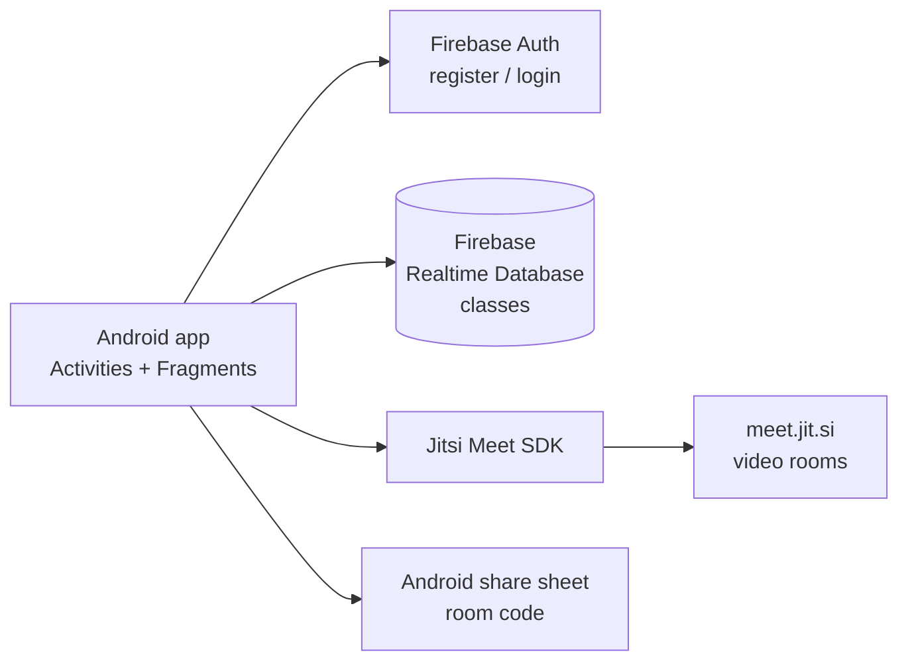

# TRLBLZRS

A virtual classroom app for Android: classes, timetables, assignments and live video lessons in one place.


## 📖 About

TRLBLZRS is a prototype of a classroom app for schools. Users sign in, see their classes and the day's timetable, open a class to find assignments, and start a live video lesson. I built it to learn multi-screen Android navigation, Firebase authentication and embedding a video calling SDK. Several screens are UI prototypes with sample data, and the core flows (auth, class creation, video calls) talk to real services.

## ✨ Features

- **Email and password sign-up and login** with Firebase Auth, regex email validation, a 6 character password rule and progress dialogs (`registerpage`, `loginpage`)
- **Home dashboard** with a class list in a `RecyclerView` and today's timetable in a custom `ListView` adapter (`HomeFragment`, `RecyclerAdapterClass`, `TTListCustomAdapter`)
- **Create a class** by class and subject, saved to Firebase Realtime Database (`Create_Class`)
- **Class screen** with Overview, People and Chat tabs using `ViewPager2` and `TabLayoutMediator` (`class_activity`, `ViewPagerClassAdapter`)
- **Live video lessons** through the Jitsi Meet SDK: join a room by code, or share the code with the Android share sheet (`VideoDashBoard`)
- **Assignments** screen that switches between writing an answer and uploading a file (`Assignment_activity`, `Write_assignment_fragment`, `Upload_assignment_fragment`)
- **Weekly timetable** as an expandable Monday to Saturday list (`Timetable`, `CustomExpandableListAdapter`)
- **Library** screens for subject material (`MyLibrary`, `LibrarySubjects`)
- **Profile** with a picture picker using the Activity Result API (`ProfileFragment`)
- **Settings** with a language picker covering 9 Indian languages that switches the app locale, plus a "Register as a Student Contributor" form (`SettingsFragment`, `RegisterAsStudentCon`)
- Bottom navigation (Home, Profile, Settings) plus a navigation drawer (`MainActivity`)

## 🧰 Tech stack

| Area | Tools |
| --- | --- |
| Language | Java 8 |
| Android | compileSdk 32, minSdk 23, ViewBinding, AppCompat, Material Components, ConstraintLayout, ViewPager2 |
| Backend services | Firebase Authentication, Firebase Realtime Database |
| Video | Jitsi Meet Android SDK 2.11 (public `meet.jit.si` server) |
| Images | Picasso, CircleImageView |
| Build | Gradle, Android Gradle Plugin 7.2, Google Services plugin |

The Firebase Storage SDK is included for profile and assignment uploads, but that code is not wired up yet.

## 🏗️ Architecture



`MainActivity` hosts the bottom navigation and drawer and swaps fragments into a single `FrameLayout`. Auth screens call Firebase Auth directly and route to `MainActivity` on success. Creating a class writes to the Realtime Database. Starting a lesson builds `JitsiMeetConferenceOptions` with the room code and launches `JitsiMeetActivity`.

```
trailblazer786/
└── app/
    └── src/main/
        ├── java/com/example/trlblzrs/
        │   ├── MainActivity.java            # bottom nav + drawer host
        │   ├── loginpage.java / registerpage.java
        │   ├── HomeFragment.java, ProfileFragment.java, SettingsFragment.java
        │   ├── class_activity.java + Class*Fragment.java
        │   ├── Assignment_activity.java + *_assignment_fragment.java
        │   ├── VideoDashBoard.java          # Jitsi Meet
        │   └── Timetable.java, MyLibrary.java, Create_Class.java
        └── res/layout/                       # activity_*, fragment_*, list items
```

## 🚀 Getting started

Prerequisites: Android Studio with JDK 11 and an Android device or emulator on API 23+.

1. Clone the repo and open the folder in Android Studio.
2. Create a Firebase project in the [Firebase console](https://console.firebase.google.com/) and add an Android app with package name `com.example.trlblzrs`.
3. Enable **Email/Password** sign-in under Authentication, and create a **Realtime Database**.
4. Download your own `google-services.json` from the Firebase console and place it in `app/`. Do not commit it.
5. Sync Gradle. The Jitsi Maven repository is already declared in `settings.gradle`.
6. Run the `app` configuration.

## 💡 What I learned

- Building a single-activity shell with `BottomNavigationView`, a `DrawerLayout` and fragment transactions.
- Wiring Firebase Auth sign-up and sign-in with client-side validation and clear-task navigation after registration.
- Embedding a third-party video SDK by setting default `JitsiMeetConferenceOptions` and launching rooms by code.
- Tabbed screens with `ViewPager2`, `FragmentStateAdapter` and `TabLayoutMediator`, and switching the app locale at runtime.

## 📌 Status

Built in 2022. Not actively maintained, and dependencies may need updating.

---

Built by Naman Chawla with [syed-ali-jibran-rizvi](https://github.com/syed-ali-jibran-rizvi) and [S-Mcode2hack](https://github.com/S-Mcode2hack) · [LinkedIn](https://www.linkedin.com/in/naman-chawla-63529b21b)
